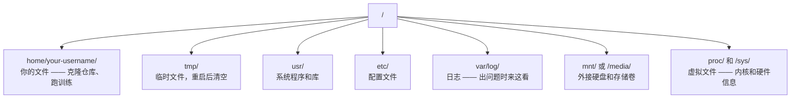

# AI 开发中的 Linux

> 大多数 AI 跑在 Linux 上。你得懂到不会被卡住的程度。

**类型：** Learn（概念学习）
**语言：** --
**前置要求：** 阶段 0，第 1 课
**预计时间：** ~30 分钟

## 学习目标

- 在 Linux 文件系统里穿行，在命令行做核心的文件操作
- 用 `chmod` 和 `chown` 管理文件权限，解决 "Permission denied" 错误
- 用 `apt` 安装系统包，从零配好一台用于 AI 工作的 GPU（图形处理器） 机器
- 认出 macOS 到 Linux 的差异，这些差异常坑在远程机器上干活的开发者

## 问题背景

你在 macOS 或 Windows 上开发。但你一旦 SSH 进一台云 GPU 机器、租一个 Lambda 实例、或开一台 EC2，你就落到了 Ubuntu 里。终端是你唯一的界面。没有 Finder，没有资源管理器，没有 GUI。如果你没法在命令行里穿行文件系统、装包、管进程，那你就会一边付着闲置的 GPU 钱，一边 google「Linux 里怎么解压文件」。

这是一份生存指南。它讲的恰好就是你在一台远程 Linux 机器上做 AI 工作所需要的。多一点都没有。

## 文件系统布局

Linux 把一切都组织在唯一的根 `/` 下面。没有 `C:\`，没有 `/Volumes`。你真正会碰到的目录：



你的主目录是 `~` 或 `/home/your-username`。你做的几乎一切都发生在这里。

## 核心命令

下面 13 个命令覆盖了你在远程 GPU 机器上的大部分日常操作。

### 四处移动

```bash
pwd                         # Where am I?
ls                          # What's here?
ls -la                      # What's here, including hidden files with details?
cd /path/to/dir             # Go there
cd ~                        # Go home
cd ..                       # Go up one level
```

### 文件和目录

```bash
mkdir my-project            # Create a directory
mkdir -p a/b/c              # Create nested directories in one shot

cp file.txt backup.txt      # Copy a file
cp -r src/ src-backup/      # Copy a directory (recursive)

mv old.txt new.txt          # Rename a file
mv file.txt /tmp/           # Move a file

rm file.txt                 # Delete a file (no trash, it's gone)
rm -rf my-dir/              # Delete a directory and everything inside
```

`rm -rf` 是永久的。没有撤销。回车前把路径再确认一遍。

### 读文件

```bash
cat file.txt                # Print entire file
head -20 file.txt           # First 20 lines
tail -20 file.txt           # Last 20 lines
tail -f log.txt             # Follow a log file in real time (Ctrl+C to stop)
less file.txt               # Scroll through a file (q to quit)
```

### 搜索

```bash
grep "error" training.log           # Find lines containing "error"
grep -r "learning_rate" .           # Search all files in current directory
grep -i "cuda" config.yaml          # Case-insensitive search

find . -name "*.py"                 # Find all Python files under current dir
find . -name "*.ckpt" -size +1G     # Find checkpoint files larger than 1GB
```

## 权限

Linux 里每个文件都有一个所有者和一组权限位。当脚本跑不起来、或你写不进某个目录时，你就会碰上它。

```bash
ls -l train.py
# -rwxr-xr-- 1 user group 2048 Mar 19 10:00 train.py
#  ^^^             owner permissions: read, write, execute
#     ^^^          group permissions: read, execute
#        ^^        everyone else: read only
```

常见修法：

```bash
chmod +x train.sh           # Make a script executable
chmod 755 deploy.sh         # Owner: full, others: read+execute
chmod 644 config.yaml       # Owner: read+write, others: read only

chown user:group file.txt   # Change who owns a file (needs sudo)
```

当某处说 "Permission denied"，几乎总是权限问题。`chmod +x` 或 `sudo` 能修好大多数情况。

## 包管理（apt）

Ubuntu 用 `apt`。这是你安装系统级软件的方式。

```bash
sudo apt update             # Refresh the package list (always do this first)
sudo apt install -y htop    # Install a package (-y skips confirmation)
sudo apt install -y build-essential  # C compiler, make, etc. Needed by many Python packages
sudo apt install -y tmux    # Terminal multiplexer (keep sessions alive after disconnect)

apt list --installed        # What's installed?
sudo apt remove htop        # Uninstall
```

在一台全新 GPU 机器上你常装的包：

```bash
sudo apt update && sudo apt install -y \
    build-essential \
    git \
    curl \
    wget \
    tmux \
    htop \
    unzip \
    python3-venv
```

## 用户和 sudo

你通常以普通用户身份登录。有些操作需要 root（管理员）权限。

```bash
whoami                      # What user am I?
sudo command                # Run a single command as root
sudo su                     # Become root (exit to go back, use sparingly)
```

在云 GPU 实例上，你通常是唯一的用户，而且已经有 sudo 权限。别什么都用 root 跑。只在需要时用 sudo。

## 进程和 systemd

当你的训练卡住、或你要看什么在跑时：

```bash
htop                        # Interactive process viewer (q to quit)
ps aux | grep python        # Find running Python processes
kill 12345                  # Gracefully stop process with PID 12345
kill -9 12345               # Force kill (use when graceful doesn't work)
nvidia-smi                  # GPU processes and memory usage
```

systemd 管理服务（后台守护进程）。你跑推理服务器时会用到它：

```bash
sudo systemctl start nginx          # Start a service
sudo systemctl stop nginx           # Stop it
sudo systemctl restart nginx        # Restart it
sudo systemctl status nginx         # Check if it's running
sudo systemctl enable nginx         # Start automatically on boot
```

## 磁盘空间

GPU 机器常常磁盘空间有限。模型和数据集填得很快。

```bash
df -h                       # Disk usage for all mounted drives
df -h /home                 # Disk usage for /home specifically

du -sh *                    # Size of each item in current directory
du -sh ~/.cache             # Size of your cache (pip, huggingface models land here)
du -sh /data/checkpoints/   # Check how big your checkpoints are

# Find the biggest space hogs
du -h --max-depth=1 / 2>/dev/null | sort -hr | head -20
```

常见的省空间办法：

```bash
# Clear pip cache
pip cache purge

# Clear apt cache
sudo apt clean

# Remove old checkpoints you don't need
rm -rf checkpoints/epoch_01/ checkpoints/epoch_02/
```

## 网络

你会在命令行里下模型、传文件、调 API（应用程序编程接口）。

```bash
# Download files
wget https://example.com/model.bin                   # Download a file
curl -O https://example.com/data.tar.gz              # Same thing with curl
curl -s https://api.example.com/health | python3 -m json.tool  # Hit an API, pretty-print JSON

# Transfer files between machines
scp model.bin user@remote:/data/                     # Copy file to remote machine
scp user@remote:/data/results.csv .                  # Copy file from remote to local
scp -r user@remote:/data/checkpoints/ ./local-dir/   # Copy directory

# Sync directories (faster than scp for large transfers, resumes on failure)
rsync -avz --progress ./data/ user@remote:/data/
rsync -avz --progress user@remote:/results/ ./results/
```

任何大的东西都用 `rsync` 而不是 `scp`。它只传变了的字节，还能处理中断的连接。

## tmux：保持会话存活

你 SSH 进一台远程机器时，合上笔记本就会杀掉你的训练任务。tmux 防住这个。

```bash
tmux new -s train           # Start a new session named "train"
# ... start your training, then:
# Ctrl+B, then D            # Detach (training keeps running)

tmux ls                     # List sessions
tmux attach -t train        # Reattach to session

# Inside tmux:
# Ctrl+B, then %            # Split pane vertically
# Ctrl+B, then "            # Split pane horizontally
# Ctrl+B, then arrow keys   # Switch between panes
```

长训练任务永远在 tmux 里跑。永远。

## Windows 用户的 WSL2

如果你用 Windows，WSL2 不用双系统就给你一个真正的 Linux 环境。

```bash
# In PowerShell (admin)
wsl --install -d Ubuntu-24.04

# After restart, open Ubuntu from Start menu
sudo apt update && sudo apt upgrade -y
```

WSL2 跑的是真正的 Linux 内核。本节课的一切在它里面都能跑。在 WSL 里，你的 Windows 文件在 `/mnt/c/Users/YourName/`。

GPU 透传在 Windows 那侧装了 NVIDIA 驱动后就能用。装 Windows 版 NVIDIA 驱动（不是 Linux 版），CUDA 就会在 WSL2 里可用。

## 坑：macOS 到 Linux

从 macOS 过来会绊到你的东西：

| macOS | Linux | 说明 |
|-------|-------|-------|
| `brew install` | `sudo apt install` | 包名有时不同。`brew install htop` 对 `sudo apt install htop` 是一样的，但 `brew install readline` 对 `sudo apt install libreadline-dev` 就不是。 |
| `open file.txt` | `xdg-open file.txt` | 但远程机器上你没有 GUI。用 `cat` 或 `less`。 |
| `pbcopy` / `pbpaste` | 没有 | 通过 SSH 没法往剪贴板里管道收发。 |
| `~/.zshrc` | `~/.bashrc` | macOS 默认 zsh。大多数 Linux 服务器用 bash。 |
| `/opt/homebrew/` | `/usr/bin/`、`/usr/local/bin/` | 可执行文件放在不同地方。 |
| `sed -i '' 's/a/b/' file` | `sed -i 's/a/b/' file` | macOS 的 sed 在 `-i` 后要跟一个空字符串。Linux 不用。 |
| 大小写不敏感的文件系统 | 大小写敏感的文件系统 | 在 Linux 上 `Model.py` 和 `model.py` 是两个不同的文件。 |
| 行尾 `\n` | 行尾 `\n` | 一样。但 Windows 用 `\r\n`，会搞坏 bash 脚本。跑 `dos2unix` 修。 |

## 速查卡

```text
Navigation:     pwd, ls, cd, find
Files:          cp, mv, rm, mkdir, cat, head, tail, less
Search:         grep, find
Permissions:    chmod, chown, sudo
Packages:       apt update, apt install
Processes:      htop, ps, kill, nvidia-smi
Services:       systemctl start/stop/restart/status
Disk:           df -h, du -sh
Network:        curl, wget, scp, rsync
Sessions:       tmux new/attach/detach
```

```figure
s0-process-fork
```

## 练习

1. SSH 进任意一台 Linux 机器（或打开 WSL2），切到你的主目录。建一个项目文件夹，用 `touch` 在里面建三个空文件，再用 `ls -la` 列出它们。
2. 用 apt 装上 `htop`，跑起来，找出哪个进程用了最多内存。
3. 启动一个 tmux 会话，在里面跑 `sleep 300`，分离，列出会话，再重新接上。
4. 用 `df -h` 查可用磁盘空间，再用 `du -sh ~/.cache/*` 找出缓存里什么在占空间。
5. 用 `scp` 把一个文件从本地传到远程，再用 `rsync` 做同样的传输，对比两者的体验。

### 提示

**练习 1。** 用 `cd ~`、`mkdir` 创建新文件夹并 `cd` 进入，然后对三个文件名执行 `touch`。在 `ls -la` 输出中，检查三个文件大小均为 0，所有者均为你的用户名。

**练习 2。** 通过 `sudo apt install -y htop` 安装并启动 htop，按 `F6`（或点击列名）按 `MEM%` 排序。列表顶部的进程占用内存最多。

**练习 3。** 按课程运行 `tmux new -s train`，启动 `sleep 300`，再按 `Ctrl+B`、`d` 脱离。用 `tmux ls` 查看会话，然后 `tmux attach -t train`；`sleep` 应仍在运行。

**练习 4。** 运行 `df -h`，读取主目录所在文件系统的 `Avail` 列。再运行 `du -sh ~/.cache/* | sort -h`，最后一行就是最大的文件夹。

**练习 5。** 先用 `scp file.txt user@host:~/` 复制文件，再对同一文件执行 `rsync -avP file.txt user@host:~/`。第二次执行 `rsync` 时几乎不传数据，因为远端文件未变。

---

[English（英文原文）](../../../../../phases/00-setup-and-tooling/11-linux-for-ai/docs/en.md) · [课后自测](../quiz.md) · [中文目录](../../../../README.md)
